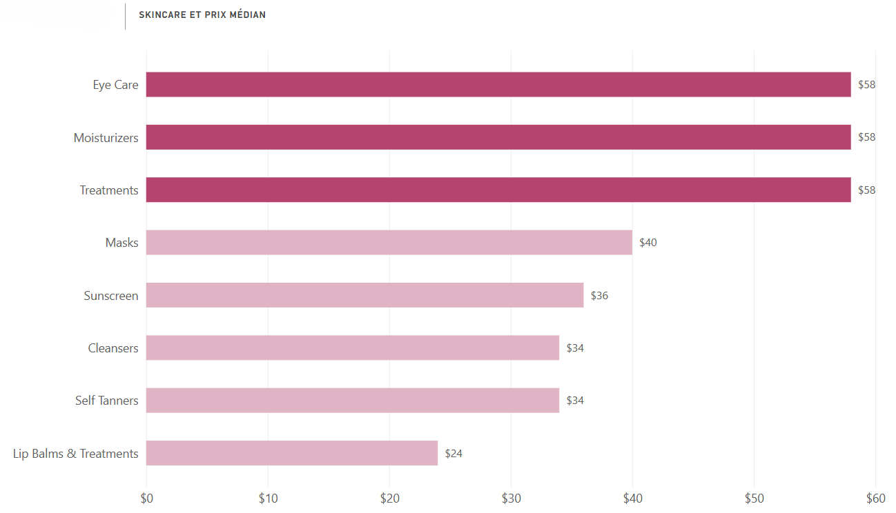
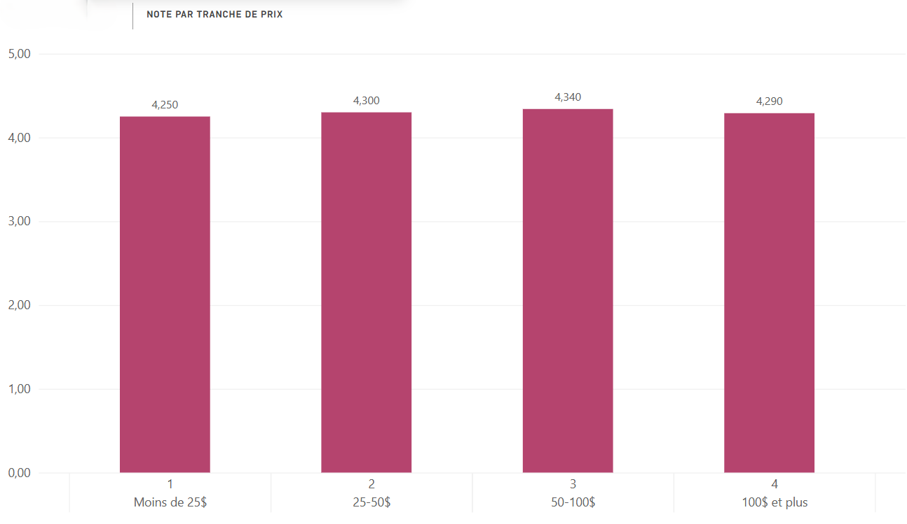
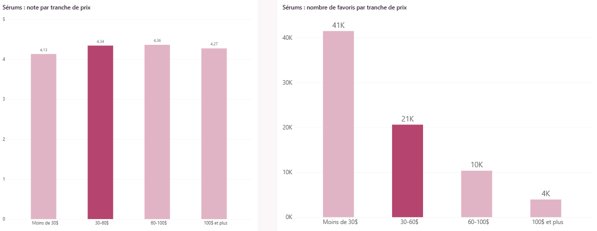
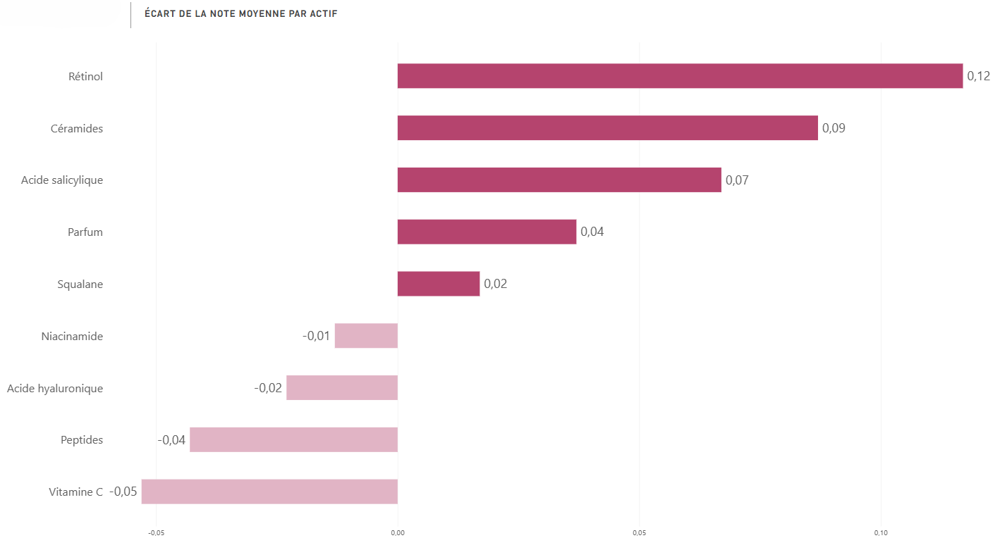
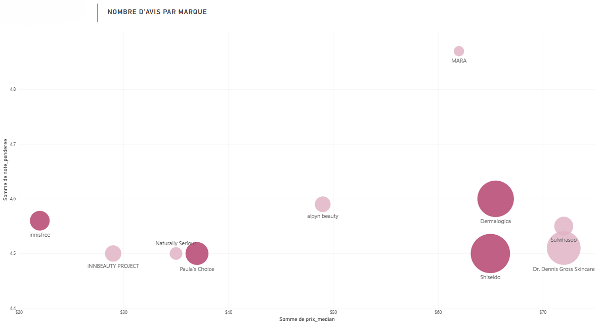

# Quel soin lancer chez Sephora ? 

Projet d'analyse de données : d'abord **SQL (SQLite)** pour explorer, nettoyer et analyser puis **Power BI** pour la visualisation.

## Le contexte

Ce projet part d'une question concrète : **si l'on lançait aujourd'hui un nouveau soin chez Sephora, lequel aurait le plus de chances de plaire aux client(e)s ?**
 
Pour y répondre, je l'ai découpée en quatre questions :
 
1. Quel **type de produit** lancer ?
2. À quel **prix** ?
3. Avec quels **actifs** ?
4. Quelles **marques** surveiller ?

Les réponses s'appuient sur les données publiques du site Sephora : prix, notes, nombre d'avis, mises en favori et listes d'ingrédients.

## La recommandation après analyse

- Lancer un sérum entre 30 et 60 $, en exclusivité Sephora, avec comme principaux actifs : le rétinol, les céramides ou l'acide salicylique.
- Plusieurs marques sont à surveiller : Dermalogica et Shiseido (très bien notées sur un gros volume d'avis), Paula's Choice (bien notée avec un prix médian de 37 $), ainsi que The Ordinary et LANEIGE (les produits les plus mis en favori).

## Les données

- Source : [Sephora Products and Skincare Reviews](https://www.kaggle.com/datasets/nadyinky/sephora-products-and-skincare-reviews) (Kaggle), fichier `product_info.csv`.
- 8 494 produits, 27 colonnes : marque, prix, note moyenne, nombre d'avis, nombre de mises en favori, liste d'ingrédients, catégories, exclusivité Sephora, nouveauté…
- Une ligne = un produit, pas de doublon.
- Les données ne contiennent pas : les ventes, les dates et la dose des ingrédients.

Le fichier de données n'est pas inclus dans ce dépôt. Vous pouvez le retrouver via `data.README.md`

## La démarche

| Étape | Fichier | Ce qui est fait |
|---|---|---|
| 1. Explorer | [01_exploration.sql](01_exploration.sql) | Taille de la base, grain, colonnes, catégories |
| 2. Contrôler la qualité | [02_qualite_donnees.sql](02_qualite_donnees.sql) | Valeurs manquantes, valeurs extrêmes, format du texte des ingrédients |
| 3. Définir le périmètre | [03_perimetre.sql](03_perimetre.sql) | Vue `skincare` : 1 952 soins |
| 4. Analyser | [04_analyse.sql](04_analyse.sql) | Les requêtes qui produisent les tableaux de `11` à `15` dans l'ordre |
| 5. Visualiser | Power BI | Les graphiques ci-dessous |

### Décisions de nettoyage

**Choix de la catégorie** : la base contient 8 494 produits répartis en 9 grandes catégories. La catégorie Skincare est la plus grande avec 2 420 produits (28.5 % de la base). C'est la catégorie visée par la question et elle contient assez de produits pour comparer des prix, des notes et des actifs de façon fiable. L'analyse porte donc sur le Skincare.

**Traitement des valeurs manquantes** : pour chaque colonne, la question est : manque d'information, ou absence normale ?
- Note : 69 soins sans note. Ils n'ont reçu aucun avis, ce qui n'équivaut pas à une note de 0. Ils seront uniquement exclus des calculs de note mais restent dans les autres comptages.
- Ingrédients : 134 soins sans liste d'ingrédients. C'est une vraie information manquante car il est impossible de savoir s'ils contiennent un actif. Ils sont exclus de l'analyse des actifs uniquement.
- Prix promotionnel : vide pour 2 375 soins. Ce n'est pas une donnée manquante, cela signifie simplement que le produit n'est pas en promotion. Ces produits sont tous gardés. Les supprimer reviendrait à perdre presque toute la base et le fait d'être en promotion ou non ne change rien aux questions posées.
- Taille  : colonne non utilisée dans l'analyse, ses valeurs manquantes n'ont pas d'effet.

**Affiner l'analyse** : dans les 2 420 produits Skincare, l'examen des sous-catégories et des prix les plus élevés a montré que certains produits ne sont pas des soins individuels.
  
| Sous-catégorie retirée | Produits | Raison |
|---|---:|---|
| Coffrets (Value & Gift Sets) | 196 | Le prix additionne plusieurs produits et la note mélange plusieurs formules |
| Minis (Mini Size) | 112 | Formats réduits : leur prix n'est pas comparable à celui d'un format normal |
| Appareils (High Tech Tools) | 80 | Masques LED, microcourant : jusqu'à 1 900 $, ils fausseraient les prix |
| Compléments alimentaires (Wellness) | 79 | Ce ne sont pas des soins de la peau |
| Shop by Concern | 1 | Catégorie à un seul produit |

Ces 468 produits sont retirés. Ainsi, seuls 1 952 soins (dont 37 sans notes et 42 sans ingrédients) seront gardés tout au long de cette analyse.

### Choix de méthode

- Prix médian plutôt que prix moyen : quelques produits de luxe tirent la moyenne vers le haut.
- Note pondérée par le nombre d'avis : une note de 5/5 sur 8 avis ne pèse pas autant qu'une note de 4.8 sur 2 800 avis.
- Note fiable (moyenne bayésienne) pour classer les produits : chaque note est rapprochée de la moyenne générale (4.30).

## Les résultats

### 1. Un soin coûte typiquement 58 $

Les **crèmes** (538 produits) et les traitements, surtout des **sérums** (368), dominent le marché avec un **prix médian de 58 $**. Le contour des yeux, la protection solaire et l'autobronzant sont les types de soin les moins bien notés.

### 2. Le prix n'explique presque pas la note

La corrélation entre prix et note est de **0.04**, elle est quasiment nulle. Les notes vont de 4.25 (moins de 25 $) à 4.34 (50-100 $) : un produit plus cher n'est pas mieux noté. Les produits à moins de 25 $ sont en revanche les plus mis en favori.

### 3. Pour un sérum, la tranche 30-60 $ est la plus intéressante

| Tranche | Sérums | Note pondérée | Favoris (médiane) |
|---|---:|---:|---:|
| Moins de 30 $ | 79 | 4.13 | 41 475 |
| **30-60 $** | **94** | **4.34** | **20 620** |
| 60-100 $ | 132 | 4.36 | 10 360 |
| 100 $ et plus | 63 | 4.27 | 3 942 |

Entre 30 et 60 $, les sérums sont presque aussi bien notés qu'entre 60 et 100 $ (4.34 contre 4.36) avec deux fois plus de favoris et moins de concurrents (94 contre 132).

### 4. Rétinol, céramides et acide salicylique : au-dessus de la moyenne

Les soins qui contiennent du **rétinol** (4.42), des **céramides** (4.39) ou de l'**acide salicylique** (4.37) sont mieux notés que la moyenne (4.30) et ces actifs sont présents dans peu de produits (4 à 10 %). Aussi, l’acide hyaluronique est présent dans 45 % des soins et n’est pas associé à une meilleure note (4.28 contre 4.30), ce n’est pas un actif pour se démarquer.

### 5. Les marques à surveiller

Parmi les marques qui ont au moins 10 soins notés :

- **Dermalogica** (40 produits, 16 969 avis, 4.60) et **Shiseido** (47 produits, 19 866 avis, 4.50) ont une très bonne note et un gros volume d'avis.
- **Paula's Choice** (prix médian 37 $) et **innisfree** (prix médian 22 $) montrent qu'on peut être bien noté sans être cher.
- **The Ordinary** et **LANEIGE** ont les produits les plus mis en favori du site avec des notes dans la moyenne (4.2 à 4.35).
Précisons qu'être populaire ne veut pas dire être mieux noté.

### 6. Exclusivités et nouveautés

- Les exclusivités Sephora sont **moins chères** (34 $ contre 50 $ en médiane) et **plus mises en favori** (15 822 contre 9 606).
- Les nouveautés ont une note moyenne de 4.57 contre 4.23, mais seulement 62 avis en médiane. Les premiers avis sont souvent plus enthousiastes. Cela ne signifie pas que les nouveautés sont meilleures.

## Les limites

- Pas de ventes ni de dates : l'analyse est axée uniquement sur la satisfaction (notes) et l'intérêt (favoris) de la clientèle et pas sur le chiffre d'affaires.
- Pas de dosage d'actifs : on sait si un actif figure dans la liste d'ingrédients, pas en quelle quantité. De plus, notons qu'un produit qui contient plusieurs actifs compte pour chacun.
- Corrélation et causalité : un actif associé à de bonnes notes n'est pas forcément la cause de ces notes.
- Association des actifs : les données ne disent pas si deux actifs sont associables.
- Le classement par note fiable place en premier un accessoire (le coton Facial Cotton de Shiseido). Il est exclu de la recommandation.

## Reproduire l'analyse
 
1. Télécharger `product_info.csv` sur Kaggle (lien dans [data.README.md](data.README.md)).
2. Dans [DB Browser for SQLite](https://sqlitebrowser.org/), créer la base avec [00_creation_base.sql](00_creation_base.sql) : table typée, import du CSV, cases vides remplacées par `NULL`.
3. Exécuter les fichiers `01` à `04` dans l'ordre.

